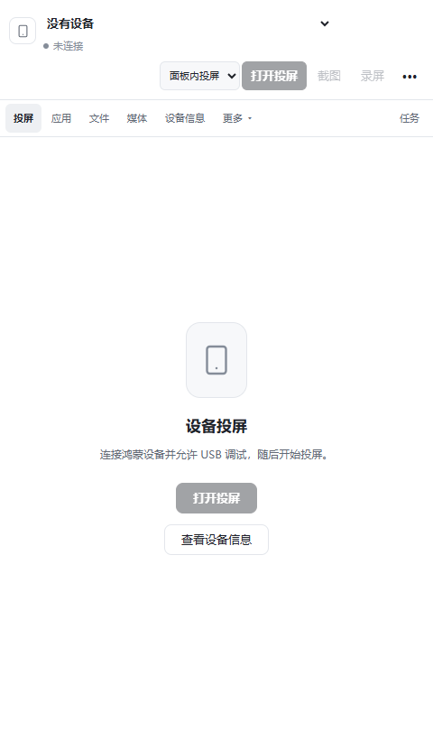
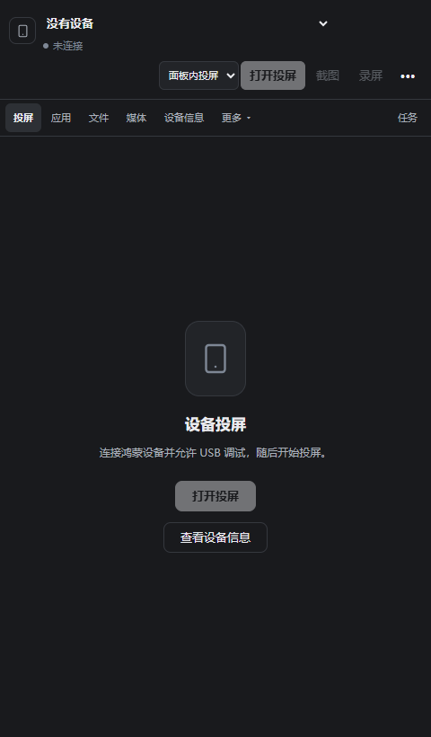
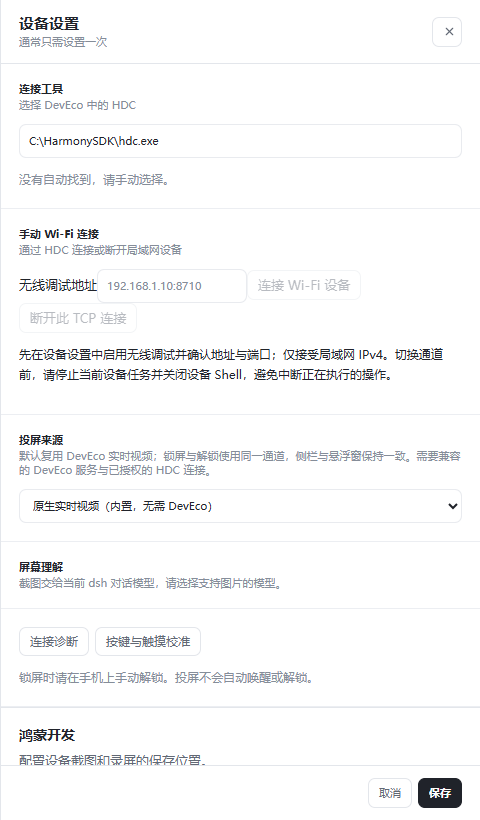

# DSH NEXT 鸿蒙设备

将 [Piora](https://github.com/kexijiang/Piora) 的鸿蒙设备工作台与 Agent 操作能力带到 **DSH NEXT 桌面版**。通过 **Better Sidebar** 注册右侧“鸿蒙设备”Tab，同时支持独立悬浮投屏。

## 功能

- 侧栏投屏与 Windows 悬浮窗相互切换；悬浮窗可置顶、缩放和拖动。
- 跟随 NEXT 深浅色与主题配色；设置使用不透明抽屉，连接详情使用独立对话框。
- 投屏、应用、文件、媒体、设备信息分开显示，设备型号、系统和序列号放在“设备信息”页。
- 保留 Piora 的设备管理、截图、录屏、应用、文件、只读数据库、日志、场景及诊断功能。
- `harmony_control` 为 Agent 提供设备枚举、页面观察、点击、滑动、文字输入等操作；截图返回 DSH 图片附件。





截图使用测试数据；不会包含真实设备或用户文件。

## 安装

目标环境：**Windows x64，DSH NEXT 2.0.21-next（内置 dsh 0.2.1-rc.4），Better Sidebar 0.28.2 或兼容版本**。当前不承诺其他桌面分支或操作系统兼容。

1. 在 NEXT 插件页面安装并启用 Better Sidebar。
2. 下载 [最新 Release](https://github.com/kexijiang/dsh-harmony/releases/latest) 中的 `dsh-plugin-harmony.tgz`，通过 NEXT 的“添加插件”安装本地包或 Release 下载地址，并启用本插件。
3. 升级已有版本后，在空闲时通过“应用 → 退出并重启”重启 NEXT，确保后端模块也更新。
4. 打开右侧边栏，点击 **＋ → 鸿蒙设备**。连接已允许 USB 调试的鸿蒙设备，选择“面板内投屏”或“悬浮投屏”，点击“打开投屏”。

预构建包地址：

```text
https://github.com/kexijiang/dsh-harmony/releases/latest/download/dsh-plugin-harmony.tgz
```

插件市场为 [dsh-market](https://github.com/dsh-market/dsh-market)，其目录来自 awesome-dsh-plugin。市场收录需要目录 PR 合并并刷新索引，仓库公开不等于已可搜索。收录前可使用上面的 Release 安装。

悬浮窗优先复用 DSH 已有 Electron；没有运行时时，首次打开会下载官方 Electron 43.3.0（约 140 MB）。也可配置 `electronPath` 指向本机 Electron。手机息屏可能暂停视频，亮屏后会恢复或可点击“重新连接”；插件不会绕过锁屏或调试授权。镜像画面用于查看，Agent 触控通过 `harmony_control` 操作。

## Agent 使用

> 使用 harmony_control 列出鸿蒙设备，读取当前页面并截图。

```json
{"operation":"list_devices"}
{"operation":"help","topic":"observe_screen"}
{"operation":"acquire_control","input":{"serial":"设备序列号"}}
{"operation":"observe_screen","input":{"serial":"设备序列号","includeScreenshot":true}}
{"operation":"release_control","input":{"serial":"设备序列号"}}
```

其他操作先通过 `help` 获取准确参数。任务结束或取消时释放设备控制租约，面板与 Agent 共用设备管理器。模型由 DSH 提供，不读取 Piora 模型凭据。

## 配置

数据默认存储在 `%USERPROFILE%\.dsh\harmony`，跟随宿主 `DSH_HOME`，不改动 Piora 数据。可在 Desktop profile 的 `cordis.patch.yml` 追加配置：

```yaml
- id: harmony
  config:
    cwd: 'C:\HarmonyWorkspace'
    dataDir: 'C:\HarmonyData'
    hdcPath: 'C:\HarmonySDK\toolchains\hdc.exe'
    # electronPath: 'C:\Electron\electron.exe'
```

省略 `hdcPath` 使用内置 Windows HDC，也可在设备设置中更改。`cwd` 是允许访问的本机工作目录；省略时使用宿主启动目录。文件操作检查真实路径和工作目录边界。HTTP 接口限制本机来源，NEXT 负责桌面认证；悬浮窗使用独立随机凭据，仅由其主进程注入请求。

## 开发与验证

```powershell
npm ci
npm run check
node scripts/check-redesign.mjs
npm run bundle
npm run install:dsh
```

本地安装脚本自动发现 NEXT，使用其自带 CLI 安装并启用 `desktop` profile，安装前备份配置。找不到 NEXT 时设置 `DSH_DESKTOP_EXE`；自定义 profile 使用 `npm run install:dsh -- profile名称`。不会调用旧的全局 dsh CLI。

`node scripts/check-native.mjs --device` 会打开连接手机的真实悬浮窗，验证视频帧、置顶、缩放、停靠、重新打开和关闭。请在设备亮屏时运行。常规检查覆盖工具协议、截图附件、取消、工作目录边界、资源清理和 HTTP 路由注销；UI 检查使用测试数据验证深浅色、抽屉及窄侧栏布局。测试输出在被忽略的 `.verification/` 内。

已在 NEXT 实际窗口进行 Better Sidebar 和真机投屏测试。应用安装/卸载、文件删除等会改变手机数据的操作没有作为 UI 冒烟测试执行。

`dsh.client.platform: web` 是 NEXT 对 Electron 渲染器使用的插件标识；本项目面向 NEXT 桌面，无需启动 `dsh web`。其页面通过 `dsh-app://app/harmony/` 和原生认证代理访问后台。

## 来源与许可

MIT。`vendor/piora` 是所需 Piora 快照，构建和运行无需原 Piora 工程。来源提交见 [provenance.json](vendor/provenance.json)，适配说明见 [ADAPTATIONS.md](vendor/ADAPTATIONS.md)，第三方组件声明见 [NOTICE.md](NOTICE.md)。
