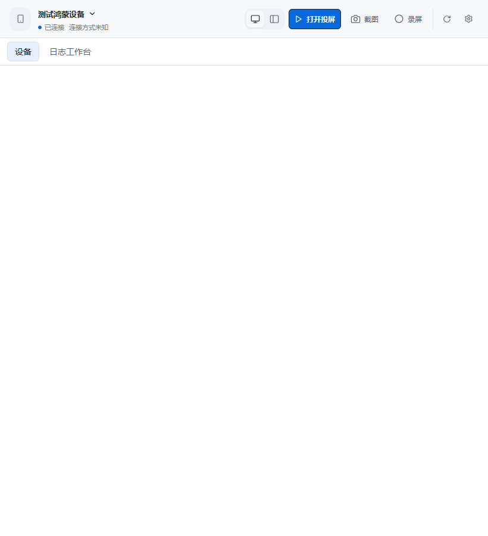
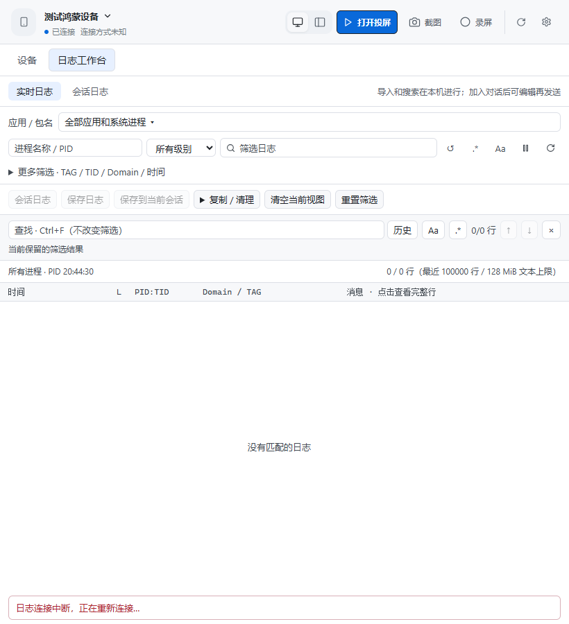
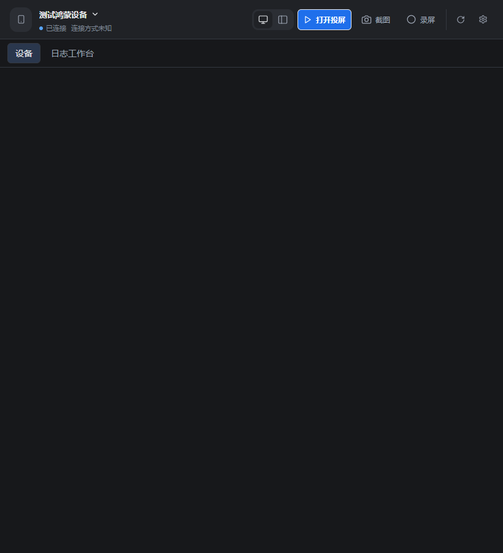
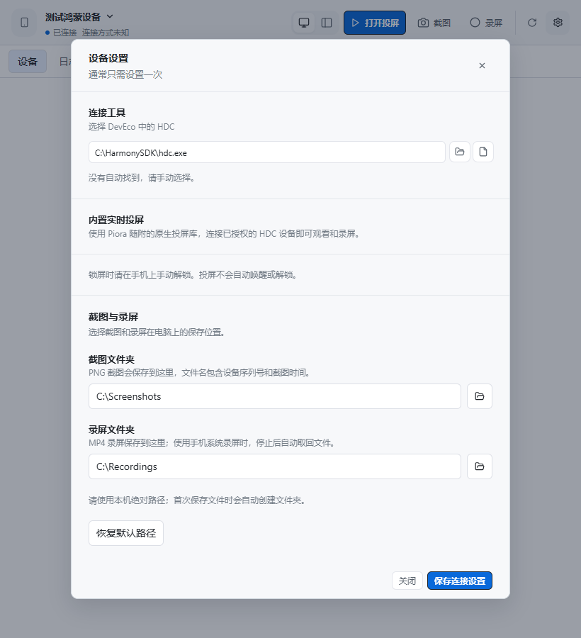

# DSH NEXT 鸿蒙设备

将 [Piora](https://github.com/kexijiang/Piora) 的鸿蒙设备工作台与 Agent 操作能力带到 **DSH NEXT 桌面版**。通过 **Better Sidebar** 注册右侧“鸿蒙设备”Tab，同时支持独立悬浮投屏。

当前版本 **0.5.0**：功能、工作台体验与输入控制对齐 Piora 最新基线（含模块化的 `HarmonyDeviceManager`、日志工作台与内置原生视频库），界面基线见 [mirror-baseline.json](vendor/mirror-baseline.json)。

## 功能

- 顶部紧凑设备栏展示设备选择、连接状态、传输渠道、只读参数响应样本、投屏位置切换、打开投屏、截图、录屏、刷新与居中设置弹窗。
- 内置双顶层视图：**设备**（侧栏或独立悬浮窗实时投屏，需手动开启“操控手机”后再派发触控/按键）与**日志工作台**（实时日志流与会话日志归档库）。
- 完整日志工作台支持实时抓取与筛选、本地 ZIP/RAR/GZ/TXT 日志压缩包导入与分块解析、跨文件正则检索、书签收藏与分析草稿一键写入 DSH 对话输入框。
- 支持多设备独立悬浮投屏窗口（每台设备独立状态与位置记忆 `harmony-mirror-windows.json`）、侧栏与悬浮模式首帧切换保护、桌面剪贴板媒体复制与本地路径定位/打开。
- 居中设置弹窗包含 HDC/SDK 路径选择与截图/录屏存储目录配置（`HarmonyStorageSettings`）；不再使用旧版 `OHScrcpyServer.hap` 或 DevEco 自动签名流程。
- 保留完整 `harmony_control` Agent 工具能力与卸载资源清理（投屏子进程、设备控制权、SQLite 快照、传输/导出队列、日志库工作线程）。
- DSH 使用自己的主题与原生窗口桥接；受 dsh-app 协议限制，在已认证渲染器运行同一视频引擎和 WebCodecs，保持宿主的权限与安全策略。
- 50ms 操作反馈目标尚未达到，本版不承诺该延迟。






公开截图使用测试数据。真实设备验收按具体包和测试结果单独记录。

## 安装

目标环境：**Windows x64，DSH NEXT 2.0.21-next（内置 dsh 0.2.1-rc.4），Better Sidebar 0.28.2 或兼容版本**。当前不承诺其他桌面分支或操作系统兼容。

1. 在 NEXT 插件页面安装并启用 Better Sidebar。
2. 下载 [最新 Release](https://github.com/kexijiang/dsh-harmony/releases/latest) 中的 `dsh-plugin-harmony.tgz`，通过 NEXT 的“添加插件”安装本地包或 Release 下载地址，并启用本插件。
3. 升级已有版本后，在空闲时通过“应用 → 退出并重启”重启 NEXT，确保后端模块也更新。
4. 打开右侧边栏，点击 **＋ → 鸿蒙设备**。连接已允许 USB 调试的鸿蒙设备，选择“面板内投屏”或“悬浮投屏”，点击“打开投屏”。

预构建包地址：

```text
https://github.com/kexijiang/dsh-harmony/releases/latest/download/dsh-plugin-harmony.tgz
```

插件市场为 [dsh-market](https://github.com/dsh-market/dsh-market)，其目录来自 awesome-dsh-plugin。市场收录需要目录 PR 合并并刷新索引，仓库公开不等于已可搜索。收录前可使用上面的 Release 安装。

悬浮窗优先复用 DSH 已有 Electron；没有运行时时，首次打开会下载官方 Electron 43.3.0（约 140 MB）。也可配置 `electronPath` 指向本机 Electron。手机息屏可能暂停视频，亮屏后会恢复或可点击“重新连接”；插件不会绕过锁屏或调试授权。投屏默认允许鼠标点击与拖动，Agent 触控通过 `harmony_control` 操作。

## Agent 使用

> 使用 harmony_control 列出鸿蒙设备，读取当前页面并截图。

```json
{"operation":"list_devices"}
{"operation":"help","topic":"observe_screen"}
{"operation":"acquire_control","input":{"serial":"设备序列号"}}
{"operation":"observe_screen","input":{"serial":"设备序列号","includeScreenshot":true}}
{"operation":"release_control","input":{"serial":"设备序列号"}}
```

其他操作先通过 `help` 获取准确参数。任务结束或取消时释放设备控制租约，面板与 Agent 共用设备管理器。模型由 DSH 提供，不读取 Piora 模型凭据。

`observe_page` 支持分页读取页面节点和祖先信息。检查器显示的是设备实际暴露的组件，不能保证取得自绘画面的内部元素；截图与结构按顺序获取，页面变化后需要刷新。快照引用属于对应观察版本，Agent 操作继续执行原有版本及状态校验。

## 配置

数据默认存储在 `%USERPROFILE%\.dsh\harmony`，跟随宿主 `DSH_HOME`，不改动 Piora 数据。可在 Desktop profile 的 `cordis.patch.yml` 追加配置：

```yaml
- id: harmony
  config:
    cwd: 'C:\HarmonyWorkspace'
    dataDir: 'C:\HarmonyData'
    hdcPath: 'C:\HarmonySDK\toolchains\hdc.exe'
    # electronPath: 'C:\Electron\electron.exe'
```

省略 `hdcPath` 使用内置 Windows HDC，也可在设备设置中更改。`cwd` 是允许访问的本机工作目录；省略时使用宿主启动目录。文件操作检查真实路径和工作目录边界。HTTP 接口限制本机来源，NEXT 负责桌面认证；悬浮窗使用独立随机凭据，仅由其主进程注入请求。

## 开发与验证

```powershell
npm ci
npm run check
node scripts/check-redesign.mjs
node scripts/check-inspector.mjs
npm run bundle
npm run install:dsh
```

本地安装脚本自动发现 NEXT，使用其自带 CLI 安装并启用 `desktop` profile，安装前备份配置。找不到 NEXT 时设置 `DSH_DESKTOP_EXE`；自定义 profile 使用 `npm run install:dsh -- profile名称`。不会调用旧的全局 dsh CLI。

`node scripts/check-native.mjs --device` 会打开连接手机的真实悬浮窗，验证视频帧、置顶、缩放、停靠、重新打开和关闭。请在设备亮屏时运行。常规检查覆盖工具协议、截图附件、取消、工作目录边界、资源清理和 HTTP 路由注销；UI 检查使用测试数据验证深浅色、抽屉及窄侧栏布局。测试输出在被忽略的 `.verification/` 内。

已在 NEXT 实际窗口进行 Better Sidebar 和真机投屏测试。应用安装/卸载、文件删除等会改变手机数据的操作没有作为 UI 冒烟测试执行。

`dsh.client.platform: web` 是 NEXT 对 Electron 渲染器使用的插件标识；本项目面向 NEXT 桌面，无需启动 `dsh web`。其页面通过 `dsh-app://app/harmony/` 和原生认证代理访问后台。

## 发布

发行包在 GitHub Actions 上构建，并作为 GitHub Release 的附件发布。安装仍使用 Release 里的 `dsh-plugin-harmony.tgz`。把 `package.json` 的 `version` 改为新版本，并在 [CHANGELOG.md](CHANGELOG.md) 增加同名小节，例如 `## 0.5.0 - 2026-11-21`。标签是 `v` 加上该版本。

```powershell
git tag v0.5.0
git push origin v0.5.0
```

推送 `v*` 标签会运行 [`.github/workflows/release.yml`](.github/workflows/release.yml)。它在 `windows-latest` 上执行与 Check 相同的 `npm run check`、`node scripts/check-redesign.mjs` 和 `node --test tests/inspector.test.mjs`。通过后用 `npm pack` 生成安装包，附件名为 `dsh-plugin-harmony.tgz`，并附带可用 `sha256sum -c` 核对的 `dsh-plugin-harmony.tgz.sha256`。Release 说明使用 CHANGELOG 里该版本的小节；没有对应小节时使用 GitHub 生成的说明。标签包含 `-alpha`、`-beta` 或 `-rc` 时标记为预发布。

工作流使用仓库自带的 `GITHUB_TOKEN`。远程需要已经有这个标签，且标签版本与 `package.json` 一致，否则工作流失败。需要补跑时，在 Actions 里手动运行 Release，输入已有标签，例如 `v0.5.0`。手动运行会检出该标签；标签上的提交需要包含这条 workflow。

## 来源与许可

MIT。`vendor/piora` 是所需 Piora 快照，构建和运行无需原 Piora 工程。来源提交见 [provenance.json](vendor/provenance.json)，适配说明见 [ADAPTATIONS.md](vendor/ADAPTATIONS.md)，第三方组件声明见 [NOTICE.md](NOTICE.md)。
